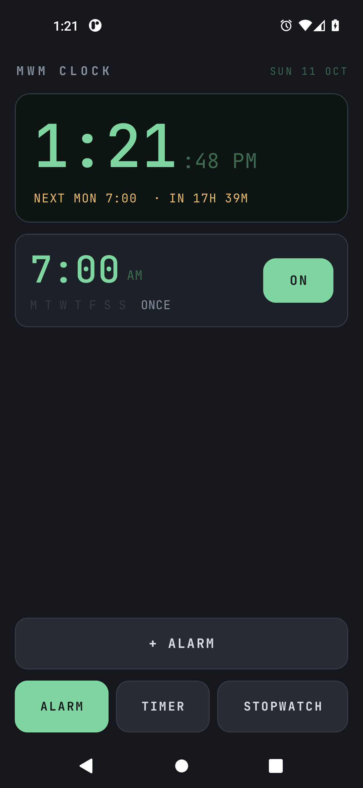

# MWM Clock

An alarm clock, timers and stopwatches for Android, on one plain screen.
It wakes you up on time and gets out of the way.

- **No ads, no account, no tracking.** The app does not ask for the internet
  permission, so it has no way to phone anywhere.
- **Alarms that ring.** Each alarm is armed with Android's alarm-clock call,
  the one that battery saving never delays, and is re-armed after a reboot,
  an app update or a time zone change. It rings over the lock screen.
- **Wakes you gently or firmly.** Per alarm: repeat days, label, sound,
  vibration, a volume that rises over 30 seconds to 3 minutes, snooze length,
  a limit on snoozes, and an optional math challenge: solve one sum, or three
  hard ones, before it goes quiet. Skip the next occurrence of a repeating
  alarm without turning it off.
- **Several timers at once.** Type a time on the keypad or tap a preset, name
  it, and start as many as you need. Each one counts down in the notification
  shade, rings when it is done, counts the overtime, and takes +1 MIN.
- **Several stopwatches at once**, each with laps, fastest and slowest lap
  marked, START ALL / STOP ALL, and names you can change. They keep their time
  when the app is closed and across a reboot.
- If an alarm volume is at zero, the alarm lifts it for the ring and puts it
  back afterwards. An alarm nobody answers goes quiet after 10 minutes.

## 📲 Download

**[⬇ Latest APK](https://github.com/Matswm86/mwm-clock/releases/download/latest/mwm-clock-0000000.apk)**
&nbsp;·&nbsp; [all builds](https://github.com/Matswm86/mwm-clock/releases)

Open the link on your phone, tap the file, and allow "install from this source"
when Android asks. Android 8.0 or newer (minSdk 26). The filename carries the
commit id on purpose, so your browser can never serve you a cached old build. If
the link 404s, a newer build has landed: grab the newest `mwm-clock-*.apk` off
the releases page.

Debug-signed. Reinstalling over a build with a different signature means
uninstalling the old one first.

## Using it

| On screen | What it means |
|-----------|---------------|
| `NEXT MON 07:00 · IN 15H 56M` | When the next alarm rings |
| `M T W T F S S` under an alarm | Its repeat days, lit in amber |
| ON / OFF | Turns that alarm on or off; tap the alarm itself to edit it |
| `SKIPPING MON 12 OCT` | You skipped that one occurrence; it rings as usual after |
| `MATH 3 HARD` | Turning this alarm off takes three hard sums |
| `-0:12` in amber | The timer finished 12 seconds ago |
| Sage and amber laps | The fastest and the slowest lap |
| Amber text under the header | A phone setting that would stop alarms working; tap it to fix |

**Permissions.** Notifications (to show the ring screen and running timers),
exact alarms (granted to alarm clocks automatically on Android 13 and newer),
full-screen alarms, start at boot, and vibration. None of them reach the
network. On some phones the maker's battery saver can still kill alarm apps:
if an alarm ever fails to ring, set battery use for MWM Clock to
"Unrestricted".

## What it deliberately does not do

- No world clock, bedtime tracking, weather or news on the alarm screen.
- No network access of any kind.
- No widgets, themes or settings screens.

## Building

There is no local build step. GitHub Actions builds the APK on every push to
`main`, runs the unit tests, then installs the APK on an emulator, saves an
alarm and checks Android's AlarmManager holds it, lets a 5-second timer ring
until the ring screen appears and stops it, and laps a stopwatch. The README
screenshot comes from that emulator run.

Kotlin and Jetpack Compose, no third-party libraries beyond AndroidX and
kotlinx.coroutines. The display font is JetBrains Mono (SIL Open Font License,
see `licenses/`).

## License

MIT, see [LICENSE](LICENSE).
